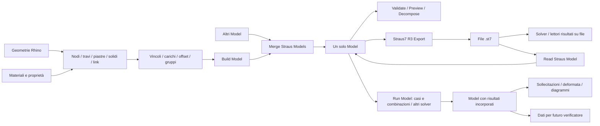

# Rhino2Straus

**Versione 0.5.2 — 9 novembre 2026.** Correzioni export/import e NLA verificate con Straus7, invalidazione cache dei solver su file, diagnostica DLL, packaging e CI. [Note di versione](docs/CHANGELOG.md) · [Verifiche eseguite e limiti](docs/VALIDATION.md).

Componenti **Rhino 8 / Grasshopper per Straus7 R3, Windows x64**. Il progetto è dedicato esclusivamente a Straus7: modellazione, attributi, modello FEM unificato, preview, esportazione `.st7`, analisi e lettura dei risultati.

**164 componenti in 17 pannelli per argomento** nella tab **Rhino2Straus**, con icone a 24 px, più le icone della libreria e del parametro Group. [Mappa dei pannelli](docs/TOPICS.md) · [Catalogo per argomento](docs/COMPONENTS.md) · [Preview e impostazioni](docs/PREVIEW.md) · [Sezioni R31, link e default](docs/SECTIONS-LINKS.md) · [Copertura API e limiti](docs/API-COVERAGE.md) · [Verifiche](docs/VALIDATION.md) · [Model, solver e risultati](docs/MODEL-RESULTS.md).

La **0.4.2** separa Materiali, Sezioni, Proprietà, Elementi, Vincoli e link, Assi e offset, Casi e combo, Carichi, Modello, File Straus, Analisi e Preview/bake. I risultati hanno cinque pannelli dedicati: Model, nodi/link, travi, piastre e solidi. Cartelle sorgenti, catalogo e atlante delle icone seguono la stessa suddivisione. I GUID e i collegamenti dei componenti restano invariati. Dopo l'installazione riavviare Rhino/Grasshopper per aggiornare la tab.

## Esempi pronti

La **0.5.0** include **23 definizioni `.gh` / `.ghx` collegate**, che utilizzano tutti i **164 componenti**: frame/polilinee, mesh Tri/Quad, solidi, link, materiali/sezioni, assi/offset, carichi, gruppi/filtri, merge e ricostruzione, export/import, quattro solver e lettori risultati. Geometrie interne, note in italiano, preview disattivabile e Brep per bake; le operazioni native sono inizialmente disattivate. [Guida e file](examples/README.md) · [Mappa componente → esempi](examples/COMPONENTS.md).

**Read Straus Model** legge un `.st7` esistente e restituisce il Model Grasshopper con dati strutturali elastici supportati. Mantiene distinti i nodi coincidenti, normalizza le unità e segnala le omissioni; l'import parziale richiede Allow partial=True. [Guida, ambito e limiti](docs/MODEL-IMPORT.md). La gestione Run/cache dei solver è condivisa e i filtri accettano le proprietà complete oltre alle sezioni legacy.

## Impostazione del modello



Gli attributi modificano copie degli elementi. `Preserve nodes=True` conserva i nodi con ID positivi distinti; viene attivato dal nuovo importatore e propagato al merge. Decompose espone anche peso proprio e questa impostazione per la ricostruzione.  `Build Model` salda i nodi entro la tolleranza, unifica i riferimenti e raccoglie proprietà, casi e combinazioni. Accetta anche altri Model. `Merge Straus Models` restituisce sempre un solo Model; `Renumber` permette di unire parti create indipendentemente. Con `Renumber=false`, gli stessi ID di elemento devono avere geometria e proprietà compatibili: i carichi si sommano come contributi e i gruppi si uniscono. Gli input restano invariati. Non collegare due volte lo stesso contributo di carico.

`Rhino2Straus Display Manager` mostra sezioni estruse, spessori, offset, carichi, vincoli, svincoli, molle, masse, spostamenti imposti, proprietà e assi. Collegare il Model assemblato e usare **Enabled** per spegnere tutte le preview gestite; **Display Settings** controlla le singole categorie, i risultati, le scale, l'ombreggiatura e la trasparenza. Il gestore sopprime automaticamente le anteprime del plugin a monte, senza cambiarne i flag Hidden. Il tasto destro offre **About**, **Guide / helper** e controlli di visibilità. `Model Physical Geometry` restituisce anche Brep/mesh Rhino. [Guida completa e limiti](docs/PREVIEW.md).

Nella **0.4** è corretta anche la conversione delle posizioni dei carichi distribuiti trave nei parametri nativi Straus7. Rigenerare esportazioni e risultati prodotti con versioni precedenti; il fingerprint distingue il nuovo contratto di export.

La **0.4.1** aggiunge l'uscita **Breps** al Display Manager e a Model Physical Geometry: volumi chiusi di travi, piastre con spessore e solidi FEM, con offset e vuoti delle sezioni. Collegarla a un parametro Brep oppure usare **Bake** dal menu del componente per creare solidi Rhino. Il bake funziona anche con preview spenta e conserva gli ID degli elementi. [Cast, bake e geometrie non convertibili](docs/PREVIEW.md#brep-e-bake-solido).

`Run Model Cases and Combinations` esporta e risolve i casi/combinazioni selezionati e restituisce **lo stesso tipo Model, con risultati immutabili incorporati**. Sono disponibili anche i solver Model per frequenze naturali, buckling e statica non lineare. Gli strumenti di allineamento lavorano sugli assi locali di travi/piastre; i lettori Model coprono nodi, travi, piastre, solidi e link. `Model Verification Data` espone geometrie, proprietà, materiali, unità, sezioni native e risultati per il verificatore futuro. [Flusso e contratto dati](docs/MODEL-RESULTS.md).

## Installazione

1. Usare Rhino **8.27 o successivo**, in modalità **.NET 8**, su Windows x64.
2. Eseguire `./build.ps1` da PowerShell con .NET SDK 8 o 9 installato.
3. Copiare il contenuto di `bin` nella cartella `Rhino2Straus` dentro **Grasshopper → File → Special Folders → Components Folder**. Sbloccare i file scaricati dalle proprietà di Windows e riavviare Rhino.
4. Installare Straus7 R3 x64 con licenza API e le licenze solver necessarie. Se non viene rilevato, impostare `STRAUS7_API_PATH` alla cartella `Bin64` oppure al file `St7api.dll`, poi riavviare Rhino.

La DLL helper ora è `Rhino2Straus.GrasshopperHelper.dll`: sostituire la precedente installazione del plugin senza lasciare la vecchia `GrasshopperHelper.dll` nella sua cartella.

La ricerca nativa prova `STRAUS7_API_PATH`, cartella dell’assembly, installazioni R31/R3 in Program Files, cartella dell’applicazione e ricerca di sistema. Gli errori elencano i percorsi tentati; una DLL presente può avere architettura incompatibile o dipendenze mancanti.

Il pacchetto distribuisce soltanto gli assembly del progetto: RhinoCommon, Grasshopper, DLL native Straus7 e manuali proprietari rimangono nelle rispettive installazioni. I GUID dei componenti Straus originali sono conservati: disabilitare il vecchio `Rhino2Fem.Grasshopper.Straus.gha` quando si installa questo plugin, per evitare registrazioni duplicate.

## Convenzioni

- Geometria, spessori, offset e dimensioni delle sezioni usano l'unità di lunghezza del Model; forze e carichi usano la sua unità di forza. Le coordinate Rhino non vengono convertite implicitamente in Build Model.
- Il modulo elastico e le tensioni lette dal solver sono in **kPa**; le resistenze nominali fy/fu/fck della libreria sono in **MPa**; densità in **tonnellate/m³**, masse nodali in tonnellate. La densità viene convertita durante l'export. Coefficiente di dilatazione in **1/°C**, convertito anche quando il Model usa °F.
- Gli angoli degli elementi Grasshopper sono in **gradi**; l'angolo degli assi della sezione generica e le rotazioni imposte sono in **radianti**. Gli strumenti di allineamento restituiscono radianti. Offset trave: componenti lungo gli assi principali 1–2, Z deve essere zero. L'inserimento della sezione si aggiunge all'offset esplicito. Offset piastra: somma di offset dell'elemento e della proprietà, lungo la normale positiva.
- I lettori diretti dei file usano i **numeri nativi Straus7**, da 1. I lettori `Model …` usano invece gli **ID del Model** e conservano anche il numero nativo nei record. `Read Straus Geometry` espone numeri e ID separatamente. Le colonne dei risultati sono descritte nei socket e conservano l'ordine API.
- Le trasformazioni FEM supportano spostamenti e rotazioni rigide. I carichi e i vincoli globali mantengono le direzioni globali. Per scale, specchiature e morph occorre ricreare gli elementi e assegnare le proprietà.

## Esportazione e analisi

`Save` oppure il fronte `Run=false → true` avvia l'export; la sola modifica degli input non scrive file. `Overwrite` è disattivato per default. L'export valida il modello, salva un file temporaneo e pubblica il `.st7` soltanto a operazione completa. L'output `Model path` collega l'export ai componenti solver.

Sono presenti statica lineare, frequenze naturali, buckling lineare e statica non lineare incrementale. Il buckling richiede risultati statici iniziali. La non lineare sostituisce la tabella degli incrementi non staged con una rampa del caso selezionato; le leggi materiali devono essere già definite nel file per abilitare la non linearità materiale. I solver sono sincroni e possono occupare Grasshopper durante il calcolo. I quattro solver su file invalidano la cache quando cambia percorso o parametro di analisi; serve un nuovo fronte Run. Le modifiche esterne dei file mantenendo gli stessi input non sono sorvegliate automaticamente.

Le temperature di riferimento dei casi e i tipi delle temperature nodali entrano ora nell’identità del Model: riesportare e ricalcolare i risultati delle versioni precedenti prima di riassociarli con la 0.5.

Le funzioni native richiedono una licenza API funzionante. Il codice compila e i test gestiti/geometrici sono separati dal collaudo Straus7: consultare [lo stato delle verifiche](docs/VALIDATION.md) prima dell'uso produttivo.

## Sviluppo

```powershell
./build.ps1
dotnet run --project Rhino2Straus.Tests -c Release
dotnet run --project tools/GeometrySmoke -c Release
dotnet run --project tools/GeometrySmoke -c Release -- --preview-gallery
dotnet run --project tools/NativeTests -c Release -- --solve
py -3 tools/import_straus_sdk.py
py -3 tools/catalogue.py --check
# Per rigenerare: py -3 tools/catalogue.py
dotnet run --project tools/IconGallery -c Release -- .
```

I tool Python richiedono Python 3; su Windows è disponibile anche `py -3`. L’audit dei quattro plugin dipende dal checkout fratello Rhino2MidasGen: vedere [INPUT-AUDIT](docs/INPUT-AUDIT.md).

Il test geometrico richiede Rhino installato e usa il resolver ufficiale Rhino.Inside; il test nativo richiede la licenza API Straus7. La CI esegue build e test gestiti. Il binding API proviene dalla parte Straus del progetto iniziale; i diritti dei rispettivi SDK rimangono ai produttori.

## Compilazione e pulizia

`./build.ps1` crea nella directory di questo progetto una sola cartella **`bin`** pronta per Grasshopper: un file `.gha` e le DLL/runtime necessari. Non cambiare i GUID per risolvere caricamenti doppi.

La build elimina i vecchi `bin/obj` intermedi, ricrea il contenuto di `bin`, esegue i test e rimuove di nuovo gli intermedi anche in caso di errore. Conserva in `artifacts` lo ZIP della versione corrente; elimina i vecchi ZIP del plugin e le vecchie distribuzioni estratte. Gli archivi degli esempi restano disponibili. Documentazione ed esempi sono nei sorgenti e nello ZIP, senza duplicati nella cartella `bin`.

- `./clean.ps1 -WhatIf`: mostra cosa verrebbe rimosso.
- `./clean.ps1`: pulisce gli intermedi e i vecchi pacchetti, conservando `bin`.
- `./build.ps1 -KeepBuildOutputs`: conserva gli intermedi per debug/sviluppo; al termine usare `./clean.ps1`.
- `./build.ps1 -SkipTests`: compila e pulisce saltando i test gestiti.

Caricare **solo questa cartella `bin`** tramite GrasshopperDeveloperSettings, oppure copiarne l'intero contenuto in un'unica cartella delle Libraries di Grasshopper. Usare una sola delle due modalità e sostituire l'installazione precedente: caricare contemporaneamente copie installate, `bin` e vecchi pacchetti genera duplicati. Le DLL accanto al `.gha` sono necessarie. Chiudere Rhino prima di ricompilare se i file sono in uso.

Gli strumenti Rhino.Inside di verifica/generazione esempi leggono il plugin da `bin`: eseguire prima `./build.ps1`. Dopo l'uso dei tool, `./clean.ps1` rimuove anche i loro intermedi.
