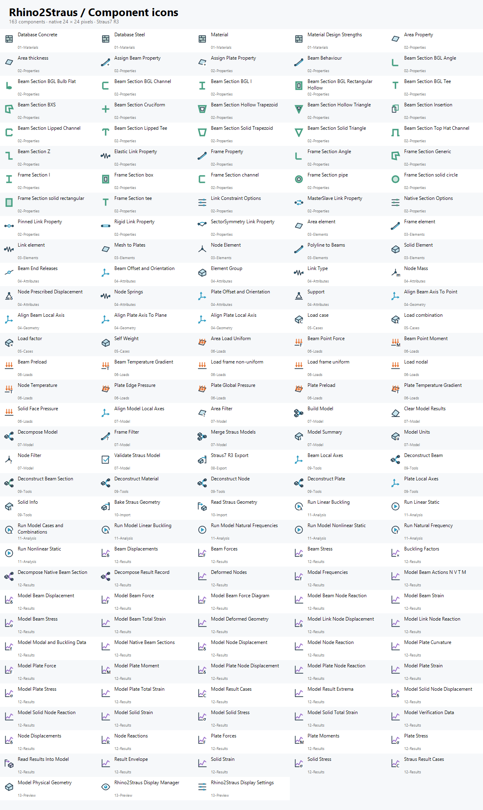

# Catalogo componenti

163 componenti Grasshopper, tutti con icona. Il parametro persistente Group e la libreria hanno icone aggiuntive.

Il percorso è sempre elementi/attributi → Build Model o Merge Straus Models → un solo Model → Preview/Run → Model con risultati → estrazione/deformata/dati per il verificatore.

| Categoria | Componente |
|---|---|
| 01-Materials | [Database Concrete](../Rhino2Straus.Grasshopper/Components/Materials/DatabaseConcreteMaterialComponent.cs) |
| 01-Materials | [Database Steel](../Rhino2Straus.Grasshopper/Components/Materials/DatabaseSteelMaterialComponent.cs) |
| 01-Materials | [Material](../Rhino2Straus.Grasshopper/Components/Materials/MaterialComponent.cs) |
| 01-Materials | [Material Design Strengths](../Rhino2Straus.Grasshopper/Components/Extended/MaterialStrengthsComponent.cs) |
| 02-Properties | [Area Property](../Rhino2Straus.Grasshopper/Components/ElementProperties/AreaPropertyComponent.cs) |
| 02-Properties | [Area thickness](../Rhino2Straus.Grasshopper/Components/ElementProperties/AreaThicknessComponent.cs) |
| 02-Properties | [Assign Beam Property](../Rhino2Straus.Grasshopper/Components/Extended/BeamAssignPropertyComponent.cs) |
| 02-Properties | [Assign Plate Property](../Rhino2Straus.Grasshopper/Components/Extended/PlateAssignPropertyComponent.cs) |
| 02-Properties | [Beam Behaviour](../Rhino2Straus.Grasshopper/Components/Extended/BeamBehaviourComponent.cs) |
| 02-Properties | [Beam Section BGL Angle](../Rhino2Straus.Grasshopper/Components/Extended/NativeSectionBglAngleComponent.cs) |
| 02-Properties | [Beam Section BGL Bulb Flat](../Rhino2Straus.Grasshopper/Components/Extended/NativeSectionBglBulbComponent.cs) |
| 02-Properties | [Beam Section BGL Channel](../Rhino2Straus.Grasshopper/Components/Extended/NativeSectionBglChannelComponent.cs) |
| 02-Properties | [Beam Section BGL I](../Rhino2Straus.Grasshopper/Components/Extended/NativeSectionBglIComponent.cs) |
| 02-Properties | [Beam Section BGL Rectangular Hollow](../Rhino2Straus.Grasshopper/Components/Extended/NativeSectionBglRhsComponent.cs) |
| 02-Properties | [Beam Section BGL Tee](../Rhino2Straus.Grasshopper/Components/Extended/NativeSectionBglTeeComponent.cs) |
| 02-Properties | [Beam Section BXS](../Rhino2Straus.Grasshopper/Components/Extended/BxsSectionComponent.cs) |
| 02-Properties | [Beam Section Cruciform](../Rhino2Straus.Grasshopper/Components/Extended/NativeSectionCruciformComponent.cs) |
| 02-Properties | [Beam Section Hollow Trapezoid](../Rhino2Straus.Grasshopper/Components/Extended/NativeSectionTrapezoidHollowComponent.cs) |
| 02-Properties | [Beam Section Hollow Triangle](../Rhino2Straus.Grasshopper/Components/Extended/NativeSectionTriangleHollowComponent.cs) |
| 02-Properties | [Beam Section Insertion](../Rhino2Straus.Grasshopper/Components/Extended/SectionInsertionComponent.cs) |
| 02-Properties | [Beam Section Lipped Channel](../Rhino2Straus.Grasshopper/Components/Extended/NativeSectionLipChannelComponent.cs) |
| 02-Properties | [Beam Section Lipped Tee](../Rhino2Straus.Grasshopper/Components/Extended/NativeSectionTeeLippedComponent.cs) |
| 02-Properties | [Beam Section Solid Trapezoid](../Rhino2Straus.Grasshopper/Components/Extended/NativeSectionTrapezoidSolidComponent.cs) |
| 02-Properties | [Beam Section Solid Triangle](../Rhino2Straus.Grasshopper/Components/Extended/NativeSectionTriangleSolidComponent.cs) |
| 02-Properties | [Beam Section Top Hat Channel](../Rhino2Straus.Grasshopper/Components/Extended/NativeSectionTopHatComponent.cs) |
| 02-Properties | [Beam Section Z](../Rhino2Straus.Grasshopper/Components/Extended/NativeSectionZComponent.cs) |
| 02-Properties | [Elastic Link Property](../Rhino2Straus.Grasshopper/Components/Extended/ElasticLinkPropertyComponent.cs) |
| 02-Properties | [Frame Property](../Rhino2Straus.Grasshopper/Components/ElementProperties/FramePropertyComponent.cs) |
| 02-Properties | [Frame Section Angle](../Rhino2Straus.Grasshopper/Components/ElementProperties/FrameSectionAngleComponent.cs) |
| 02-Properties | [Frame Section Generic](../Rhino2Straus.Grasshopper/Components/ElementProperties/FrameSectionGenericComponent.cs) |
| 02-Properties | [Frame Section I](../Rhino2Straus.Grasshopper/Components/ElementProperties/FrameSectionIComponent.cs) |
| 02-Properties | [Frame Section box](../Rhino2Straus.Grasshopper/Components/ElementProperties/FrameSectionBoxComponent.cs) |
| 02-Properties | [Frame Section channel](../Rhino2Straus.Grasshopper/Components/ElementProperties/FrameSectionChannelComponent.cs) |
| 02-Properties | [Frame Section pipe](../Rhino2Straus.Grasshopper/Components/ElementProperties/FrameSectionPipeComponent.cs) |
| 02-Properties | [Frame Section solid circle](../Rhino2Straus.Grasshopper/Components/ElementProperties/FrameSectionCircleComponent.cs) |
| 02-Properties | [Frame Section solid rectangular](../Rhino2Straus.Grasshopper/Components/ElementProperties/FrameSectionRectangularComponent.cs) |
| 02-Properties | [Frame Section tee](../Rhino2Straus.Grasshopper/Components/ElementProperties/FrameSectionTeeComponent.cs) |
| 02-Properties | [Link Constraint Options](../Rhino2Straus.Grasshopper/Components/Extended/LinkConstraintOptionsComponent.cs) |
| 02-Properties | [MasterSlave Link Property](../Rhino2Straus.Grasshopper/Components/Extended/MasterSlaveLinkPropertyComponent.cs) |
| 02-Properties | [Native Section Options](../Rhino2Straus.Grasshopper/Components/Extended/NativeSectionOptionsComponent.cs) |
| 02-Properties | [Pinned Link Property](../Rhino2Straus.Grasshopper/Components/Extended/PinnedLinkPropertyComponent.cs) |
| 02-Properties | [Rigid Link Property](../Rhino2Straus.Grasshopper/Components/Extended/RigidLinkPropertyComponent.cs) |
| 02-Properties | [SectorSymmetry Link Property](../Rhino2Straus.Grasshopper/Components/Extended/SectorSymmetryLinkPropertyComponent.cs) |
| 03-Elements | [Area element](../Rhino2Straus.Grasshopper/Components/Elements/AreaElementComponent.cs) |
| 03-Elements | [Frame element](../Rhino2Straus.Grasshopper/Components/Elements/FrameElementComponent.cs) |
| 03-Elements | [Link element](../Rhino2Straus.Grasshopper/Components/Elements/LinkElementComponent.cs) |
| 03-Elements | [Mesh to Plates](../Rhino2Straus.Grasshopper/Components/Extended/MeshPlatesComponent.cs) |
| 03-Elements | [Node Element](../Rhino2Straus.Grasshopper/Components/Elements/NodeElementComponent.cs) |
| 03-Elements | [Polyline to Beams](../Rhino2Straus.Grasshopper/Components/Extended/PolylineBeamsComponent.cs) |
| 03-Elements | [Solid Element](../Rhino2Straus.Grasshopper/Components/Extended/SolidElementComponent.cs) |
| 04-Attributes | [Beam End Releases](../Rhino2Straus.Grasshopper/Components/Extended/BeamReleasesComponent.cs) |
| 04-Attributes | [Beam Offset and Orientation](../Rhino2Straus.Grasshopper/Components/Extended/BeamOffsetComponent.cs) |
| 04-Attributes | [Element Group](../Rhino2Straus.Grasshopper/Components/Attributes/ElementGroupComponent.cs) |
| 04-Attributes | [Link Type](../Rhino2Straus.Grasshopper/Components/ElementProperties/LinkPropertyComponent.cs) |
| 04-Attributes | [Node Mass](../Rhino2Straus.Grasshopper/Components/Extended/NodeMassComponent.cs) |
| 04-Attributes | [Node Prescribed Displacement](../Rhino2Straus.Grasshopper/Components/Extended/PrescribedDisplacementComponent.cs) |
| 04-Attributes | [Node Springs](../Rhino2Straus.Grasshopper/Components/Extended/NodeSpringComponent.cs) |
| 04-Attributes | [Plate Offset and Orientation](../Rhino2Straus.Grasshopper/Components/Extended/PlateOffsetComponent.cs) |
| 04-Attributes | [Support](../Rhino2Straus.Grasshopper/Components/Attributes/NodeSupportComponent.cs) |
| 04-Geometry | [Align Beam Axis To Point](../Rhino2Straus.Grasshopper/Components/Extended/AlignBeamToPointComponent.cs) |
| 04-Geometry | [Align Beam Local Axis](../Rhino2Straus.Grasshopper/Components/Extended/AlignBeamAxisComponent.cs) |
| 04-Geometry | [Align Plate Axis To Plane](../Rhino2Straus.Grasshopper/Components/Extended/AlignPlateToPlaneComponent.cs) |
| 04-Geometry | [Align Plate Local Axis](../Rhino2Straus.Grasshopper/Components/Extended/AlignPlateAxisComponent.cs) |
| 05-Cases | [Load case](../Rhino2Straus.Grasshopper/Components/Cases/LoadCaseComponent.cs) |
| 05-Cases | [Load combination](../Rhino2Straus.Grasshopper/Components/Cases/LoadCombinationComponent.cs) |
| 05-Cases | [Load factor](../Rhino2Straus.Grasshopper/Components/Cases/LoadFactorComponent.cs) |
| 05-Cases | [Self Weight](../Rhino2Straus.Grasshopper/Components/Extended/SelfWeightComponent.cs) |
| 06-Loads | [Area Load Uniform](../Rhino2Straus.Grasshopper/Components/Loads/LoadAreaUniformComponent.cs) |
| 06-Loads | [Beam Point Force](../Rhino2Straus.Grasshopper/Components/Extended/BeamPointForceComponent.cs) |
| 06-Loads | [Beam Point Moment](../Rhino2Straus.Grasshopper/Components/Extended/BeamPointMomentComponent.cs) |
| 06-Loads | [Beam Preload](../Rhino2Straus.Grasshopper/Components/Extended/BeamPreloadComponent.cs) |
| 06-Loads | [Beam Temperature Gradient](../Rhino2Straus.Grasshopper/Components/Extended/BeamGradientComponent.cs) |
| 06-Loads | [Load frame non-uniform](../Rhino2Straus.Grasshopper/Components/Loads/LoadFrameNonUniComponent.cs) |
| 06-Loads | [Load frame uniform](../Rhino2Straus.Grasshopper/Components/Loads/LoadFrameUniformComponent.cs) |
| 06-Loads | [Load nodal](../Rhino2Straus.Grasshopper/Components/Loads/LoadNodalComponent.cs) |
| 06-Loads | [Node Temperature](../Rhino2Straus.Grasshopper/Components/Extended/NodeTemperatureComponent.cs) |
| 06-Loads | [Plate Edge Pressure](../Rhino2Straus.Grasshopper/Components/Extended/PlateEdgePressureComponent.cs) |
| 06-Loads | [Plate Global Pressure](../Rhino2Straus.Grasshopper/Components/Extended/GlobalPressureComponent.cs) |
| 06-Loads | [Plate Preload](../Rhino2Straus.Grasshopper/Components/Extended/PlatePreloadComponent.cs) |
| 06-Loads | [Plate Temperature Gradient](../Rhino2Straus.Grasshopper/Components/Extended/PlateGradientComponent.cs) |
| 06-Loads | [Solid Face Pressure](../Rhino2Straus.Grasshopper/Components/Extended/SolidPressureComponent.cs) |
| 07-Model | [Align Model Local Axes](../Rhino2Straus.Grasshopper/Components/Extended/AlignModelAxesComponent.cs) |
| 07-Model | [Area Filter](../Rhino2Straus.Grasshopper/Components/Tools/AreaFilterComponent.cs) |
| 07-Model | [Build Model](../Rhino2Straus.Grasshopper/Components/Models/BuildModelComponent.cs) |
| 07-Model | [Clear Model Results](../Rhino2Straus.Grasshopper/Components/Extended/ClearModelResultsComponent.cs) |
| 07-Model | [Decompose Model](../Rhino2Straus.Grasshopper/Components/Models/DecomposeModelComponent.cs) |
| 07-Model | [Frame Filter](../Rhino2Straus.Grasshopper/Components/Tools/FrameFilterComponent.cs) |
| 07-Model | [Merge Straus Models](../Rhino2Straus.Grasshopper/Components/Extended/MergeModelsComponent.cs) |
| 07-Model | [Model Summary](../Rhino2Straus.Grasshopper/Components/Extended/ModelSummaryComponent.cs) |
| 07-Model | [Model Units](../Rhino2Straus.Grasshopper/Components/Models/ModelUnitsComponent.cs) |
| 07-Model | [Node Filter](../Rhino2Straus.Grasshopper/Components/Tools/NodeFilterComponent.cs) |
| 07-Model | [Validate Straus Model](../Rhino2Straus.Grasshopper/Components/Extended/ValidateModelComponent.cs) |
| 08-Export | [Straus7 R3 Export](../Rhino2Straus.Grasshopper/Components/Export/StrausR3ExportComponent.cs) |
| 09-Tools | [Beam Local Axes](../Rhino2Straus.Grasshopper/Components/Extended/BeamAxesComponent.cs) |
| 09-Tools | [Deconstruct Beam](../Rhino2Straus.Grasshopper/Components/Extended/BeamInfoComponent.cs) |
| 09-Tools | [Deconstruct Beam Section](../Rhino2Straus.Grasshopper/Components/Extended/SectionInfoComponent.cs) |
| 09-Tools | [Deconstruct Material](../Rhino2Straus.Grasshopper/Components/Extended/MaterialInfoComponent.cs) |
| 09-Tools | [Deconstruct Node](../Rhino2Straus.Grasshopper/Components/Extended/NodeInfoComponent.cs) |
| 09-Tools | [Deconstruct Plate](../Rhino2Straus.Grasshopper/Components/Extended/PlateInfoComponent.cs) |
| 09-Tools | [Plate Local Axes](../Rhino2Straus.Grasshopper/Components/Extended/PlateAxesComponent.cs) |
| 09-Tools | [Solid Info](../Rhino2Straus.Grasshopper/Components/Extended/SolidInfoComponent.cs) |
| 10-Import | [Bake Straus Geometry](../Rhino2Straus.Grasshopper/Components/Extended/BakeStrausGeometryComponent.cs) |
| 10-Import | [Read Straus Geometry](../Rhino2Straus.Grasshopper/Components/Extended/ReadStrausGeometryComponent.cs) |
| 11-Analysis | [Run Linear Buckling](../Rhino2Straus.Grasshopper/Components/Extended/RunLinearBucklingComponent.cs) |
| 11-Analysis | [Run Linear Static](../Rhino2Straus.Grasshopper/Components/Extended/RunLinearStaticComponent.cs) |
| 11-Analysis | [Run Model Cases and Combinations](../Rhino2Straus.Grasshopper/Components/Extended/RunModelCasesComponent.cs) |
| 11-Analysis | [Run Model Linear Buckling](../Rhino2Straus.Grasshopper/Components/Extended/RunModelBucklingComponent.cs) |
| 11-Analysis | [Run Model Natural Frequencies](../Rhino2Straus.Grasshopper/Components/Extended/RunModelModalComponent.cs) |
| 11-Analysis | [Run Model Nonlinear Static](../Rhino2Straus.Grasshopper/Components/Extended/RunModelNonlinearComponent.cs) |
| 11-Analysis | [Run Natural Frequency](../Rhino2Straus.Grasshopper/Components/Extended/RunNaturalFrequencyComponent.cs) |
| 11-Analysis | [Run Nonlinear Static](../Rhino2Straus.Grasshopper/Components/Extended/RunNonlinearStaticComponent.cs) |
| 12-Results | [Beam Displacements](../Rhino2Straus.Grasshopper/Components/Extended/BeamDisplacementResultsComponent.cs) |
| 12-Results | [Beam Forces](../Rhino2Straus.Grasshopper/Components/Extended/BeamForcesComponent.cs) |
| 12-Results | [Beam Stress](../Rhino2Straus.Grasshopper/Components/Extended/BeamStressComponent.cs) |
| 12-Results | [Buckling Factors](../Rhino2Straus.Grasshopper/Components/Extended/BucklingFactorsComponent.cs) |
| 12-Results | [Decompose Native Beam Section](../Rhino2Straus.Grasshopper/Components/Extended/DecomposeNativeSectionComponent.cs) |
| 12-Results | [Decompose Result Record](../Rhino2Straus.Grasshopper/Components/Extended/DecomposeResultRecordComponent.cs) |
| 12-Results | [Deformed Nodes](../Rhino2Straus.Grasshopper/Components/Extended/DeformedNodesComponent.cs) |
| 12-Results | [Modal Frequencies](../Rhino2Straus.Grasshopper/Components/Extended/ModalResultsComponent.cs) |
| 12-Results | [Model Beam Actions N V T M](../Rhino2Straus.Grasshopper/Components/Extended/ModelBeamActionsComponent.cs) |
| 12-Results | [Model Beam Displacement](../Rhino2Straus.Grasshopper/Components/Extended/ModelBeamDisplacementComponent.cs) |
| 12-Results | [Model Beam Force](../Rhino2Straus.Grasshopper/Components/Extended/ModelBeamForceComponent.cs) |
| 12-Results | [Model Beam Force Diagram](../Rhino2Straus.Grasshopper/Components/Extended/ModelBeamDiagramComponent.cs) |
| 12-Results | [Model Beam Node Reaction](../Rhino2Straus.Grasshopper/Components/Extended/ModelBeamNodeReactionComponent.cs) |
| 12-Results | [Model Beam Strain](../Rhino2Straus.Grasshopper/Components/Extended/ModelBeamStrainComponent.cs) |
| 12-Results | [Model Beam Stress](../Rhino2Straus.Grasshopper/Components/Extended/ModelBeamStressComponent.cs) |
| 12-Results | [Model Beam Total Strain](../Rhino2Straus.Grasshopper/Components/Extended/ModelBeamTotalStrainComponent.cs) |
| 12-Results | [Model Deformed Geometry](../Rhino2Straus.Grasshopper/Components/Extended/ModelDeformedGeometryComponent.cs) |
| 12-Results | [Model Link Node Displacement](../Rhino2Straus.Grasshopper/Components/Extended/ModelLinkNodeDisplacementComponent.cs) |
| 12-Results | [Model Link Node Reaction](../Rhino2Straus.Grasshopper/Components/Extended/ModelLinkNodeReactionComponent.cs) |
| 12-Results | [Model Modal and Buckling Data](../Rhino2Straus.Grasshopper/Components/Extended/ModelModalMetadataComponent.cs) |
| 12-Results | [Model Native Beam Sections](../Rhino2Straus.Grasshopper/Components/Extended/ModelNativeSectionsComponent.cs) |
| 12-Results | [Model Node Displacement](../Rhino2Straus.Grasshopper/Components/Extended/ModelNodeDisplacementComponent.cs) |
| 12-Results | [Model Node Reaction](../Rhino2Straus.Grasshopper/Components/Extended/ModelNodeReactionComponent.cs) |
| 12-Results | [Model Plate Curvature](../Rhino2Straus.Grasshopper/Components/Extended/ModelPlateCurvatureComponent.cs) |
| 12-Results | [Model Plate Force](../Rhino2Straus.Grasshopper/Components/Extended/ModelPlateForceComponent.cs) |
| 12-Results | [Model Plate Moment](../Rhino2Straus.Grasshopper/Components/Extended/ModelPlateMomentComponent.cs) |
| 12-Results | [Model Plate Node Displacement](../Rhino2Straus.Grasshopper/Components/Extended/ModelPlateNodeDisplacementComponent.cs) |
| 12-Results | [Model Plate Node Reaction](../Rhino2Straus.Grasshopper/Components/Extended/ModelPlateNodeReactionComponent.cs) |
| 12-Results | [Model Plate Strain](../Rhino2Straus.Grasshopper/Components/Extended/ModelPlateStrainComponent.cs) |
| 12-Results | [Model Plate Stress](../Rhino2Straus.Grasshopper/Components/Extended/ModelPlateStressComponent.cs) |
| 12-Results | [Model Plate Total Strain](../Rhino2Straus.Grasshopper/Components/Extended/ModelPlateTotalStrainComponent.cs) |
| 12-Results | [Model Result Cases](../Rhino2Straus.Grasshopper/Components/Extended/ModelResultCasesComponent.cs) |
| 12-Results | [Model Result Extrema](../Rhino2Straus.Grasshopper/Components/Extended/ModelResultEnvelopeComponent.cs) |
| 12-Results | [Model Solid Node Displacement](../Rhino2Straus.Grasshopper/Components/Extended/ModelSolidNodeDisplacementComponent.cs) |
| 12-Results | [Model Solid Node Reaction](../Rhino2Straus.Grasshopper/Components/Extended/ModelSolidNodeReactionComponent.cs) |
| 12-Results | [Model Solid Strain](../Rhino2Straus.Grasshopper/Components/Extended/ModelSolidStrainComponent.cs) |
| 12-Results | [Model Solid Stress](../Rhino2Straus.Grasshopper/Components/Extended/ModelSolidStressComponent.cs) |
| 12-Results | [Model Solid Total Strain](../Rhino2Straus.Grasshopper/Components/Extended/ModelSolidTotalStrainComponent.cs) |
| 12-Results | [Model Verification Data](../Rhino2Straus.Grasshopper/Components/Extended/ModelVerificationDataComponent.cs) |
| 12-Results | [Node Displacements](../Rhino2Straus.Grasshopper/Components/Extended/NodeDisplacementsComponent.cs) |
| 12-Results | [Node Reactions](../Rhino2Straus.Grasshopper/Components/Extended/NodeReactionsComponent.cs) |
| 12-Results | [Plate Forces](../Rhino2Straus.Grasshopper/Components/Extended/PlateForceResultsComponent.cs) |
| 12-Results | [Plate Moments](../Rhino2Straus.Grasshopper/Components/Extended/PlateMomentResultsComponent.cs) |
| 12-Results | [Plate Stress](../Rhino2Straus.Grasshopper/Components/Extended/PlateStressResultsComponent.cs) |
| 12-Results | [Read Results Into Model](../Rhino2Straus.Grasshopper/Components/Extended/ReadResultsIntoModelComponent.cs) |
| 12-Results | [Result Envelope](../Rhino2Straus.Grasshopper/Components/Extended/ResultEnvelopeComponent.cs) |
| 12-Results | [Solid Strain](../Rhino2Straus.Grasshopper/Components/Extended/SolidStrainResultsComponent.cs) |
| 12-Results | [Solid Stress](../Rhino2Straus.Grasshopper/Components/Extended/SolidStressResultsComponent.cs) |
| 12-Results | [Straus Result Cases](../Rhino2Straus.Grasshopper/Components/Extended/StrausResultCasesComponent.cs) |
| 13-Preview | [Model Physical Geometry](../Rhino2Straus.Grasshopper/Components/Extended/ModelGeometryComponent.cs) |
| 13-Preview | [Rhino2Straus Display Manager](../Rhino2Straus.Grasshopper/Components/Extended/PreviewModelComponent.cs) |
| 13-Preview | [Rhino2Straus Display Settings](../Rhino2Straus.Grasshopper/Components/Extended/DisplaySettingsComponent.cs) |

