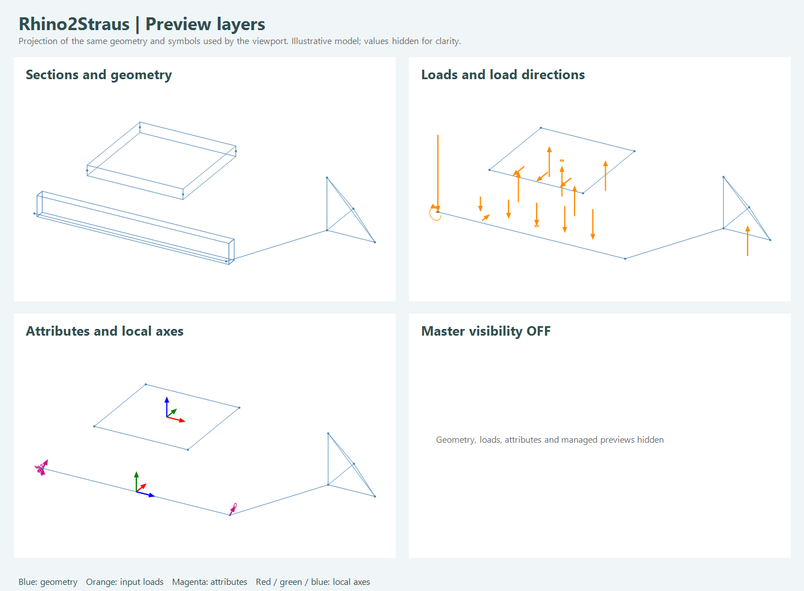

# Rhino2Straus Display Manager

Collegare **un solo Model**, proveniente da Build Model o Merge Straus Models, al componente nella categoria **13-Preview**. Il componente aggiorna il precedente `Preview Straus Model`, conservandone GUID e primi sette input.

Il gestore disegna geometrie, sezioni e spessori fisici, carichi e attributi. **Enabled=false** spegne la sua preview e quelle automatiche del plugin che gestisce. Le impostazioni non cambiano il Model, i carichi, i risultati o i file Straus7.

## Controlli

- Collegare **Rhino2Straus Display Settings** per interruttori indipendenti: Nodes, Beams, Plates, Solids, Links, Sections, Loads, Supports, Releases, Springs, Masses, Prescribed, Offsets, Axes, Labels, Properties, Values e Results.
- `Sections=false` conserva gli assi delle travi e la superficie media delle piastre; `Shaded=false` conserva soltanto i contorni. Trasparenza: 0 opaco, 1 trasparente.
- `Symbol scale` controlla la dimensione dei simboli e degli assi, in unità del Model. `Load scale` moltiplica le lunghezze delle frecce; per leggibilità sono limitate a sei dimensioni di simbolo. I momenti sono archi orientati con la regola della mano destra. Le etichette conservano i valori applicati: le dimensioni dei simboli non rappresentano un risultato di calcolo.
- `Load cases` accetta nomi esatti, disponibili all'uscita `Available cases`. Vuoto mostra tutti i casi di input. Non somma combinazioni; le etichette riportano il caso di appartenenza. Il filtro non elimina i vincoli o gli altri attributi.
- `Values` controlla testi e unità dei simboli; `Labels` gli ID; `Properties` nomi di materiali, sezioni/proprietà, spessori e tipo/opzioni dei link. Le categorie possono essere abilitate separatamente per ridurre la sovrapposizione.
- `Results` abilita la preview dei componenti della categoria 12-Results, per esempio deformate e diagrammi. Non avvia analisi né calcola automaticamente questi risultati. Il master OFF li nasconde insieme alle altre preview gestite.

Un input `Settings` collegato ha precedenza sui precedenti input Solid/Labels/Axes/Supports/scales e sui menu di categoria. L'interruttore Enabled del gestore resta sempre efficace.

## Brep e bake solido

Dalla versione **0.4.1**, il Display Manager e **Model Physical Geometry** espongono **Breps** e **Brep issues**, mantenendo inalterato l'ordine delle uscite precedenti.

1. Collegare il Model assemblato al gestore.
2. Collegare **Breps** a un parametro Brep Grasshopper per operazioni geometriche o un bake selettivo.
3. Per il bake completo, usare **Bake** nel menu del Display Manager o di Model Physical Geometry e scegliere layer/attributi nella finestra standard Grasshopper.

Il bake dal componente crea soltanto i Brep fisici chiusi, senza duplicare linee, mesh, simboli di carico o annotazioni. Non avviene automaticamente al ricalcolo. Supporta Undo e, se Rhino rifiuta un oggetto, rimuove gli oggetti appena creati da quella singola operazione.

- **Travi:** estrusioni chiuse del profilo, con orientamento, inserimento e offset; i vuoti dei profili tubolari restano vuoti. Le sezioni composte producono più solidi, conservando tutte le parti.
- **Piastre:** Brep chiusi ottenuti dalla geometria con spessore membranale e somma degli offset di elemento e proprietà.
- **Solidi FEM:** Tet4, Wedge6 ed Hexa8 convertiti in Brep chiusi dalla loro pelle geometrica.

L'albero usa i percorsi **{tipo; ID del Model}**, con tipo `0=trave`, `1=piastra`, `2=solido`; ogni ramo contiene tutte le parti di quell'elemento. Tipo, ID e indice della parte sono conservati nei user string `Rhino2Straus.ElementType`, `Rhino2Straus.ElementId`, `Rhino2Straus.PartIndex`, sulla geometria e sugli attributi degli oggetti creati dal bake del componente. Le coordinate coincidono con la preview, senza conversione implicita delle unità.

L'uscita Breps e il bake sono **indipendenti dalla visibilità**, inclusi Enabled e Sections: spegnere la preview non elimina la geometria disponibile. L'uscita ha la propria preview disattivata per evitare sovrapposizioni; un parametro Brep a valle usa invece i normali controlli di Grasshopper.

Anche i singoli elementi trave, piastra e solido possono essere collegati direttamente a un parametro Brep. Il cast singolo è disponibile quando l'elemento produce un solo volume; per sezioni composte e Model interi usare l'uscita Breps, così nessuna parte viene persa. La conversione produce nuove geometrie e non modifica il Model o i suoi risultati.

**Brep issues** elenca gli elementi esclusi: profilo assente, spessore nullo oppure geometria che non forma un solido chiuso valido. Non viene inventata una sezione per le travi generiche. Nodi, link e simboli non hanno un volume fisico definito e non sono inclusi. I solidi rimangono separati per elemento; eventuali unioni booleane sono operazioni successive dell'utente.

## About e guida

Con il tasto destro sul gestore sono disponibili:

- **Rhino2Straus — display enabled**, interruttore generale;
- **Visibility categories**, controlli rapidi se Settings non è collegato;
- **About Rhino2Straus**, nome/versione del plugin e descrizione del flusso a Model unico;
- **Guide / helper**, istruzioni, precedenza degli input e legenda.

Gli interruttori del menu vengono salvati nel documento Grasshopper e supportano Undo. Gli input già collegati mantengono la precedenza sui corrispondenti controlli di menu.

## Cosa viene mostrato

| Categoria | Preview |
|---|---|
| Geometria | Nodi, linee di trave, piastre, solidi e link |
| Sezioni | Profili estrusi, spessori, inserimento e offset; profili 2D anche sui parametri Section prima dell'assemblaggio |
| Carichi nodali | Frecce di forza, archi di momento, temperatura |
| Carichi trave | Forze/momenti concentrati e distribuiti, posizione relativa, trasformazione assi principali/globali, proiezione; etichette per gradienti termici e pretensione/predeformazione |
| Carichi piastra | Pressione normale sulla faccia -z, pressione globale sulla faccia selezionata, pressione di bordo; etichette per gradiente termico e prestress/prestrain |
| Carichi solido | Pressioni con numerazione delle facce nativa Straus7 e direzione entrante per valori positivi |
| Peso proprio | Indicazione della gravità e delle opzioni di massa, nel relativo caso |
| Vincoli | Simboli distinti per traslazioni e rotazioni bloccate, con DOF nelle etichette |
| Altri attributi | Svincoli di estremità, molle, masse, spostamenti imposti, vettori di offset e assi locali |

Per una **sezione generica numerica** non è possibile ricavare un profilo univoco da A/I/J: collegare il Brep planare XY al componente Generic. Se manca, il gestore segnala la presenza di sezioni senza profilo e mostra le linee di analisi. Le sezioni native già create vengono visualizzate dai dati memorizzati; il disegno non chiama Straus7. La creazione dei profili BGL/BXS resta soggetta ai requisiti API documentati separatamente.

## Gestione delle preview automatiche

`Manage previews=true` sopprime le preview automatiche degli altri componenti Rhino2Straus e dei parametri FEM nel documento corrente, senza modificarne i flag Hidden. Nascondere o spegnere il gestore mantiene la soppressione; rimuoverlo, scollegarne il Model o impostare Manage previews=false ripristina le preview automatiche. Altri documenti, oggetti Rhino e altri plugin restano indipendenti. La geometria Rhino copiata verso parametri o componenti di altri plugin usa i loro normali controlli di preview.

È possibile usare più gestori per Model diversi: ognuno disegna il proprio Model con le proprie impostazioni. Per spegnere tutto, spegnere tutti i gestori attivi. Il gestore rifiuta una lista di Model: unirli esplicitamente prima.

La scena limita le annotazioni a 25.000 simboli e segnala il limite: filtrare i casi o le categorie per i modelli grandi. La copertura riguarda i dati implementati dal plugin; non ricostruisce attributi mancanti da un import puramente geometrico.

## Verifica e aggiornamento

I test controllano direzioni e posizioni, offset, numerazione delle facce, filtri, categorie, master OFF, separazione dei documenti e ripristino dopo rimozione. La cattura GPU del viewport non è disponibile nell'ambiente automatico; la tavola seguente è una **proiezione delle stesse primitive geometriche**, non uno screenshot dell'interfaccia. Il collaudo interattivo finale nel viewport rimane da effettuare.

La verifica dei diagrammi ha corretto anche la conversione della posizione finale dei carichi distribuiti nel parametro nativo `b`: il manuale R3, pagina stampata 1010, usa una distanza dall'estremo finale per Constant/Linear/ThreePoint e una posizione per Trapezoidal. Il componente continua a ricevere A/B come posizioni dall'inizio. **Rigenerare esportazione e risultati dopo l'aggiornamento alla 0.4**, specialmente per i carichi distribuiti: l'identificatore degli input distingue il nuovo contratto di export. Il comportamento nativo richiede ancora il collaudo con licenza API.
