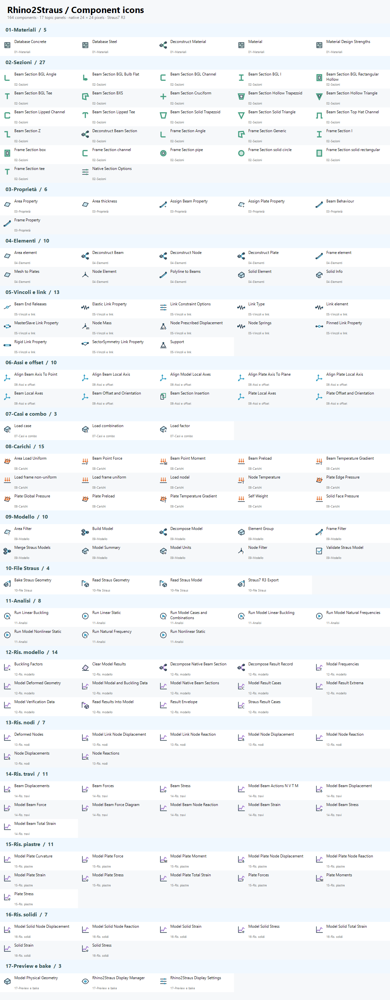

# Argomenti nella tab Rhino2Straus

I pannelli della tab Grasshopper sono ordinati per fase di lavoro. I risultati sono suddivisi per tipo di elemento. Le cartelle sorgenti e il catalogo seguono gli stessi argomenti.

| Pannello Grasshopper | Contenuto | Componenti |
|---|---|---:|
| [01-Materiali](../Rhino2Straus.Grasshopper/Components/Materials) | Materiali, librerie, resistenze e lettura delle proprietà del materiale. | 5 |
| [02-Sezioni](../Rhino2Straus.Grasshopper/Components/Sections) | Sezioni standard, generiche, BXS e BGL; opzioni native e decomposizione del profilo. | 27 |
| [03-Proprietà](../Rhino2Straus.Grasshopper/Components/Properties) | Proprietà di travi e piastre, spessori, comportamento e assegnazione agli elementi. | 6 |
| [04-Elementi](../Rhino2Straus.Grasshopper/Components/Elements) | Creazione di nodi, travi, piastre e solidi; conversione delle geometrie e decomposizione degli elementi. | 10 |
| [05-Vincoli e link](../Rhino2Straus.Grasshopper/Components/ConstraintsLinks) | Vincoli, svincoli, molle, masse, spostamenti imposti e creazione/proprietà dei link. | 13 |
| [06-Assi e offset](../Rhino2Straus.Grasshopper/Components/AxesOffsets) | Assi locali, allineamenti, orientamento, offset e inserimento delle sezioni. | 10 |
| [07-Casi e combo](../Rhino2Straus.Grasshopper/Components/Cases) | Casi di carico, fattori e combinazioni. | 3 |
| [08-Carichi](../Rhino2Straus.Grasshopper/Components/Loads) | Peso proprio e carichi nodali, su travi, piastre e solidi, inclusi termici e preload. | 15 |
| [09-Modello](../Rhino2Straus.Grasshopper/Components/Model) | Unità, Build, Merge, validazione, riepilogo, decomposizione, filtri e gruppi del Model unico. | 10 |
| [10-File Straus](../Rhino2Straus.Grasshopper/Components/Files) | Esportazione .st7, lettura e bake della geometria da file Straus7. | 4 |
| [11-Analisi](../Rhino2Straus.Grasshopper/Components/Analysis) | Esecuzione di casi e combinazioni, statica lineare/non lineare, modi e buckling. | 8 |
| [12-Ris. modello](../Rhino2Straus.Grasshopper/Components/ResultsModel) | Lettura nel Model, casi risultato, estremi, metadati, deformata e dati per il verificatore. | 14 |
| [13-Ris. nodi](../Rhino2Straus.Grasshopper/Components/ResultsNodes) | Spostamenti, reazioni e deformata dei nodi; risultati nodali dei link. | 7 |
| [14-Ris. travi](../Rhino2Straus.Grasshopper/Components/ResultsBeams) | Azioni, tensioni, deformazioni, spostamenti e diagrammi delle travi. | 11 |
| [15-Ris. piastre](../Rhino2Straus.Grasshopper/Components/ResultsPlates) | Forze, momenti, tensioni, deformazioni, curvature e risultati nodali delle piastre. | 11 |
| [16-Ris. solidi](../Rhino2Straus.Grasshopper/Components/ResultsSolids) | Tensioni, deformazioni e risultati nodali dei solidi FEM. | 7 |
| [17-Preview e bake](../Rhino2Straus.Grasshopper/Components/Preview) | Display Manager, impostazioni di visualizzazione, geometrie fisiche, Brep e bake solido. | 3 |

Il parametro **Group** si trova in **09-Modello** accanto ai componenti dei gruppi. Le sezioni BGL/BXS e le opzioni native si trovano in **02-Sezioni**; le loro eventuali dipendenze API rimangono quelle documentate nella guida alle sezioni.

Il pannello **17-Preview e bake** contiene Display Manager, Display Settings e Model Physical Geometry. Il controllo `Results` del gestore continua ad agire su tutti e cinque i pannelli dei risultati.

Per vedere la nuova disposizione, sostituire il pacchetto del plugin e riavviare Rhino/Grasshopper. Nomi, GUID, input e output dei componenti sono conservati; le definizioni Grasshopper esistenti continuano a usare gli stessi componenti e collegamenti.

Le cartelle sono state riordinate, conservando i namespace esistenti per compatibilità. Le etichette, l’ordine e la classificazione dei risultati sono definiti in [ComponentTopics.cs](../Rhino2Straus.Grasshopper.Types/UI/ComponentTopics.cs). `tools/catalogue.py` verifica che ciascuna cartella corrisponda al pannello dichiarato e genera questa guida e il [catalogo completo](COMPONENTS.md).

